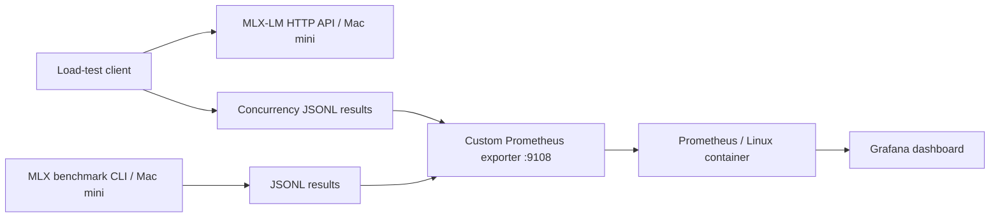

# Local LLM Inference: Benchmarking & Observability

A reproducible homelab experiment measuring how context length and concurrent API requests affect local LLM inference throughput, latency, and memory. The goal is **performance engineering**, not maximizing benchmark scores.

## Architecture



### Example environment

| Layer | Example implementation |
| --- | --- |
| Inference | Apple M4 Mac mini, 16 GB unified memory, macOS, MLX-LM |
| Model | `Qwen/Qwen3-4B-MLX-4bit` |
| Monitoring host | Small Intel x86 computer running Proxmox + Debian LXC |
| Metrics | Python `prometheus-client` exporter, Prometheus |
| Visualization | Grafana dashboard JSON in this repository |

Use local hostnames/IPs from **your own environment**. The repository does not contain any production systems, private addresses, user data, API tokens, or recorded prompts from private sources.

## Quick start

Python 3.12+ recommended. On an Apple Silicon Mac:

```bash
python3 -m venv .venv
source .venv/bin/activate
python -m pip install mlx-lm prometheus-client
```

### 1. Single-request benchmarks

```bash
python mlx_exporter.py benchmark -p 1024 -g 128
python mlx_exporter.py benchmark -p 2048 -g 128
python mlx_exporter.py benchmark -p 4096 -g 128
python mlx_exporter.py benchmark -p 8192 -g 128
```

The exporter saves latest benchmark measurements in `benchmark_results.jsonl`, which is deliberately gitignored. Measured metrics include prefill throughput, decode throughput and reported peak MLX memory. Prefill/decode durations and TTFT are **estimates derived from measured throughput**, not separate first-token timing instruments.

### 2. Serve the model and test concurrency

In terminal A:

```bash
mlx_lm.server --model Qwen/Qwen3-4B-MLX-4bit --host 127.0.0.1 --port 8080
```

In terminal B:

```bash
python concurrency_benchmark.py --concurrency 1 2 5 10 --requests 30 --max-tokens 128
```

The load generator uses Python's standard library and stores completed run summaries in `concurrency_results.jsonl` (gitignored). The output includes success count, P50/P95 **end-to-end latency**, aggregate output tokens/second, and successful requests/second.

> **Important:** this is a non-streaming, synthetic workload. It does **not** measure TTFT, streaming inter-token latency, scheduling internals, exact GPU occupancy, or production user capacity. Results can also be affected by prompt-cache reuse, warmup, model configuration, background load, and short sample sizes.

### 3. Expose results to Prometheus

```bash
python mlx_exporter.py serve --host <MAC_LAN_IP> --port 9108
```

Configure Prometheus in your monitoring container to scrape the Mac over a trusted LAN:

```yaml
scrape_configs:
  - job_name: mlx-mac-mini
    scrape_interval: 15s
    static_configs:
      - targets: ['<MAC_LAN_IP>:9108']
```

Import `mlx-inference-benchmark-dashboard.json` into Grafana and select your Prometheus datasource. The dashboard queries the `mlx-mac-mini` job; adjust the job name in the JSON/queries if your scrape configuration differs.

**Security:** the exporter has no authentication. Bind it to a trusted LAN address only and restrict access via host/network firewall. The MLX-LM API in these examples is loopback-only and must not be exposed directly to the internet.

## Example findings (one homelab run)

The following are *illustrative measurements from one Mac mini M4 + Qwen3-4B run*, not generalized model benchmarks:

| Concurrent requests | Aggregate output tokens/s | P50 latency | P95 latency |
| ---: | ---: | ---: | ---: |
| 1 | 40.22 | 3.17 s | 3.24 s |
| 2 | 78.41 | 3.26 s | 3.29 s |
| 5 | 114.89 | 5.57 s | 5.81 s |
| 10 | 118.73 | 10.75 s | 10.99 s |

Between 5 and 10 concurrent requests, throughput rose by about **3.3%** while median latency rose by about **93%**. This suggests a throughput plateau for this specific synthetic workload and setup. It does **not** prove a hardware capacity ceiling or establish an optimal production concurrency setting.

## Metric semantics

- `mlx_prefill_tokens_per_second`: benchmark-reported prompt-processing rate.
- `mlx_generation_tokens_per_second`: benchmark-reported output token rate.
- `mlx_peak_memory_gb`: benchmark-reported MLX peak memory, **not dedicated KV cache usage**.
- `mlx_estimated_ttft_seconds`: estimated only, **not measured TTFT**.
- `mlx_concurrency_output_tokens_per_second`: output token total divided by full wall-clock test duration, including scheduling and idle time.
- `mlx_concurrency_p50_latency_seconds` and `mlx_concurrency_p95_latency_seconds`: successful non-streaming request completion latencies.
- `mlx_concurrency_successes` / `mlx_concurrency_requests`: counts for the latest completed run at each model/concurrency combination.

Prometheus scrapes the **latest completed test per configuration**; its horizontal chart lines are *retained samples*, not ongoing inference. Historical runs remain in local JSONL files and are not automatically exported as individual time series.

## Limitations and next experiments

1. Measure real streaming TTFT and inter-token latency.
2. Run repeated mixed-prompt/mixed-output tests with warmup and confidence intervals.
3. Observe OS/MLX memory behavior and the influence of batching and prompt-cache reuse.
4. Compare other model sizes/quantizations with identical request distributions.

## License

MIT. See [LICENSE](LICENSE).
